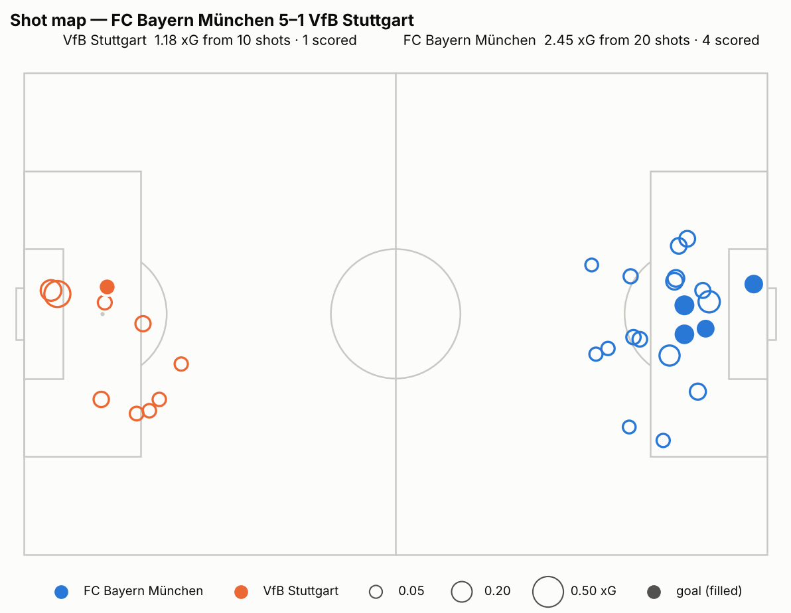
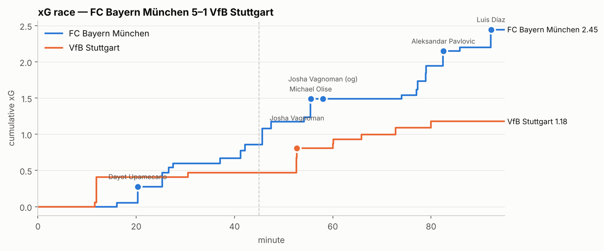
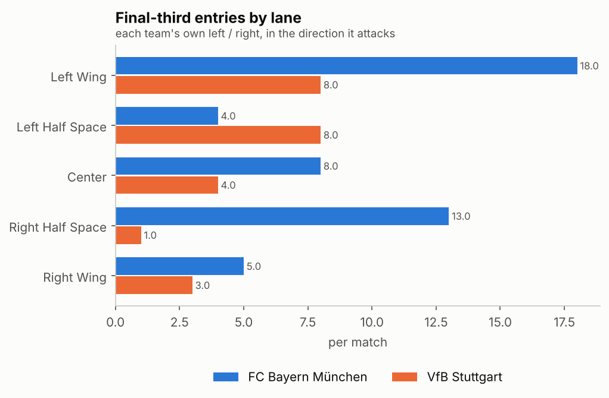

# FC Bayern München 5–1 VfB Stuttgart

_Bundesliga 2026-2027 · 2026-08-28 · match id 268382_

## Summary

Bayern won 5–1 and the model xG agrees they were clearly better (2.45 to 1.18 from 20 shots to 10), but the margin flatters them. They scored four times from 2.45 xG and added an own goal. The game was decided by territory: Bayern had a 66.5% field tilt and 25 box entries to Stuttgart's 6. Stuttgart's 5-2-2-1 kept the score level until a set piece broke it at 20'. After the break, Kimmich's interception at 54' and the 57' own goal ended it inside three minutes.

## Goals

| clock | team | scorer | own_goal | type | phase | xg | assist |
|---|---|---|---|---|---|---|---|
| 20:20.2050 | FC Bayern München | Dayot Upamecano | False | HEADER | SET_PIECE | 0.22 | Joshua Kimmich |
| 51:38.4750 | VfB Stuttgart | Josha Vagnoman | False | MID_RANGE_SHOT | SECOND_BALL | 0.14 |  |
| 54:27.7080 | FC Bayern München | Michael Olise | False | ONE_VS_ONE_AGAINST_GK | IN_POSSESSION | 0.25 | Joshua Kimmich |
| 56:57.5040 | FC Bayern München | Josha Vagnoman | True |  | SET_PIECE |  |  |
| 81:25.5640 | FC Bayern München | Aleksandar Pavlovic | False | CLOSE_RANGE_SHOT | IN_POSSESSION | 0.20 | Ismael Saibari |
| 90:00.0000 (+01:07.5450) | FC Bayern München | Luis Díaz | False | ONE_VS_ONE_AGAINST_GK | ATTACKING_TRANSITION | 0.25 | Ismael Saibari |

## Team stats

| | FC Bayern München | VfB Stuttgart |
|---|---|---|
| Goals | 5 | 1 |
| xG | 2.45 | 1.18 |
| Non-penalty xG | 2.45 | 1.18 |
| Shots | 20 | 10 |
| Shots on target | 9 | 4 |
| Big chances (xG ≥ 0.3) | 0 | 1 |
| xG per shot | 0.12 | 0.12 |
| Set-piece xG | 0.61 | 0.19 |
| Possession % (pass share) | 59.4 | 40.6 |
| Passes | 564 | 385 |
| Pass accuracy % | 83.4 | 73.4 |
| Long passes % | 12.9 | 13.0 |
| Progressive passes | 42 | 21 |
| Final-third entries | 48 | 24 |
| Box entries | 25 | 6 |
| Crosses | 15 | 8 |
| Field tilt % | 66.5 | 33.5 |
| PPDA (lower = more pressing) | 9.2 | 8.7 |
| Regains | 124 | 99 |
| High regains (≤40 m from goal) | 28 | 26 |
| Unsuccessful passes + dribbles | 103 | 99 |
| …of which ground passes/dribbles | 41 | 33 |
| Ground losses in own half | 20 | 10 |
| Avg pressure on opp. build-up | 26.9 | 27.6 |
| Formation | 4-2-3-1 | 5-2-2-1 |
| Yellow / red cards | 1 / 0 | 3 / 0 |

### By half

| | FC Bayern München xG (shots) | VfB Stuttgart xG (shots) |
|---|---|---|
| 1st half | 1.08 (9) | 0.47 (3) |
| 2nd half | 1.37 (11) | 0.71 (7) |

### xG by phase

| phase | FC Bayern München | VfB Stuttgart |
|---|---|---|
| ATTACKING_TRANSITION | 0.62 | 0.35 |
| IN_POSSESSION | 1.17 | 0.15 |
| SECOND_BALL | 0.05 | 0.49 |
| SET_PIECE | 0.61 | 0.19 |

## Set pieces

| team | corners | att. free kicks | penalties | set-piece shots | set-piece xG | goals |
|---|---|---|---|---|---|---|
| FC Bayern München | 9 | 1 | 0 | 5 | 0.61 | 1 |
| VfB Stuttgart | 3 | 3 | 0 | 1 | 0.09 | 0 |

## Key players

### FC Bayern München

| player | position | first_min | last_min | goals | shots | xg | key_passes | xa | passes | pass_pct | prog_passes | box_entries | regains | losses |
|---|---|---|---|---|---|---|---|---|---|---|---|---|---|---|
| Luis Díaz | LEFT_WINGER | 0 | 95 | 1 | 6 | 0.81 | 1 | 0.08 | 47 | 83.30 | 0 | 4 | 5 | 10 |
| Michael Olise | RIGHT_WINGER | 3 | 95 | 1 | 6 | 0.73 | 0 | 0.00 | 45 | 87.20 | 4 | 7 | 7 | 9 |
| Ismael Saibari | ATTACKING_MIDFIELD | 62 | 95 | 0 | 1 | 0.10 | 3 | 0.57 | 13 | 100.00 | 2 | 1 | 2 | 2 |
| Alphonso Davies | LEFT_WINGBACK_DEFENDER | 0 | 73 | 0 | 0 | 0.00 | 4 | 0.46 | 45 | 85.70 | 8 | 4 | 7 | 7 |
| Joshua Kimmich | DEFENSE_MIDFIELD | 1 | 95 | 0 | 0 | 0.00 | 2 | 0.48 | 62 | 81.40 | 3 | 1 | 19 | 11 |
| Aleksandar Pavlovic | DEFENSE_MIDFIELD | 1 | 82 | 1 | 2 | 0.28 | 1 | 0.10 | 65 | 86.90 | 4 | 3 | 17 | 8 |
| Harry Kane | CENTER_FORWARD | 2 | 82 | 0 | 2 | 0.13 | 2 | 0.28 | 23 | 72.20 | 1 | 1 | 4 | 7 |
| Dayot Upamecano | CENTRAL_DEFENDER | 0 | 94 | 1 | 1 | 0.22 | 1 | 0.10 | 62 | 86.40 | 2 | 0 | 21 | 8 |

### VfB Stuttgart

| player | position | first_min | last_min | goals | shots | xg | key_passes | xa | passes | pass_pct | prog_passes | box_entries | regains | losses |
|---|---|---|---|---|---|---|---|---|---|---|---|---|---|---|
| Grischa Prömel | DEFENSE_MIDFIELD | 1 | 94 | 0 | 1 | 0.07 | 2 | 0.44 | 37 | 79.40 | 2 | 1 | 12 | 8 |
| Tiago Tomás | ATTACKING_MIDFIELD | 0 | 60 | 0 | 2 | 0.41 | 0 | 0.00 | 25 | 66.70 | 1 | 0 | 7 | 7 |
| Maximilian Mittelstädt | LEFT_WINGBACK_DEFENDER | 1 | 94 | 0 | 2 | 0.12 | 1 | 0.20 | 43 | 59.00 | 3 | 2 | 11 | 16 |
| Jeff Chabot | CENTRAL_DEFENDER | 1 | 71 | 0 | 1 | 0.20 | 0 | 0.00 | 24 | 83.30 | 0 | 0 | 8 | 4 |
| Dzenan Pejcinovic | CENTER_FORWARD | 4 | 59 | 0 | 1 | 0.06 | 1 | 0.06 | 19 | 66.70 | 2 | 1 | 4 | 5 |
| Ermedin Demirovic | CENTER_FORWARD | 63 | 93 | 0 | 2 | 0.18 | 0 | 0.00 | 9 | 50.00 | 0 | 0 | 3 | 4 |
| Angelo Stiller | DEFENSE_MIDFIELD | 2 | 85 | 0 | 0 | 0.00 | 2 | 0.13 | 45 | 88.60 | 1 | 0 | 9 | 6 |
| Jamie Leweling | ATTACKING_MIDFIELD | 63 | 94 | 0 | 0 | 0.00 | 1 | 0.09 | 9 | 77.80 | 1 | 2 | 3 | 3 |

## Biggest chances

| clock | team | player | action | phase | xg | goal | on_target | assister |
|---|---|---|---|---|---|---|---|---|
| 11:53.4230 | VfB Stuttgart | Tiago Tomás | CLOSE_RANGE_SHOT | SECOND_BALL | 0.35 | False | False | Grischa Prömel |
| 54:27.1400 | FC Bayern München | Michael Olise | ONE_VS_ONE_AGAINST_GK | IN_POSSESSION | 0.25 | True | True | Joshua Kimmich |
| 90:00.0000 (+01:07.1100) | FC Bayern München | Luis Díaz | ONE_VS_ONE_AGAINST_GK | ATTACKING_TRANSITION | 0.25 | True | True | Ismael Saibari |
| 20:18.3620 | FC Bayern München | Dayot Upamecano | HEADER | SET_PIECE | 0.22 | True | True | Joshua Kimmich |
| 45:00.0000 (+00:38.8440) | FC Bayern München | Michael Olise | CLOSE_RANGE_SHOT | ATTACKING_TRANSITION | 0.22 | False | True | Alphonso Davies |
| 51:34.8140 | VfB Stuttgart | Jeff Chabot | HEADER | ATTACKING_TRANSITION | 0.20 | False | True | Maximilian Mittelstädt |
| 81:25.2230 | FC Bayern München | Aleksandar Pavlovic | CLOSE_RANGE_SHOT | IN_POSSESSION | 0.20 | True | True | Ismael Saibari |
| 25:18.7570 | FC Bayern München | Luis Díaz | ONE_VS_ONE_AGAINST_GK | IN_POSSESSION | 0.19 | False | True | Harry Kane |

## How the goals came

- **20' Upamecano (1–0)**: Kimmich corner from the left, headed in from the 6-yard area (xG 0.22). The goal came out of Bayern's dominant corner game (9 corners to 3).
- **52' Vagnoman (1–1)**: Stuttgart's best spell. Neuer saved Chabot's header (0.20) and Vagnoman hit the rebound from 12 m (0.14). Both chances came from second balls, which is the phase where Stuttgart out-created Bayern (0.49 xG to 0.05).
- **54' Olise (2–1)**: Kimmich intercepted on the right edge of the final third, carried inside and slid Olise through 1v1 (0.25). It was a textbook high regain.
- **57' own goal (3–1)**: a Kimmich free kick from wide right reached Davies, whose cut-back was turned into his own net by Vagnoman under pressure.
- **81' Pavlovic (4–1)**: after Kane won a loose ball from a Stuttgart free kick, Neuer went long diagonally to the right. Olise chipped it on, and substitute Saibari carried 22 m to the byline and cut back to Pavlovic at 9 m (0.20).
- **90+1' Díaz (5–1)**: Bischof intercepted in midfield, Saibari played Díaz in, and Díaz scored 1v1 in transition (0.25).

## In possession

Bayern controlled the ball (59% of passes, 83% accuracy vs 73%) and moved it forward far more: 42 progressive passes to 21 and 48 final-third entries to 24. Most of their threat came from settled possession (1.17 xG in possession vs Stuttgart's 0.15). They added transitions (0.62) and set pieces (0.61). Olise (7 box entries) and Davies (8 progressive passes, 4 key passes) drove most of it. Chance quality was moderate rather than elite, at 0.12 xG per shot and no shot above 0.3. Bayern won through volume, not clear-cut chances.

Stuttgart almost never built through Bayern. Their 0.15 in-possession xG and 6 box entries show that nearly all their threat came from second balls and transitions. Mittelstädt was the most-used outlet down the left, but he completed only 59% of his passes and lost the ball 16 times.

## Out of possession

Both teams pressed with similar intensity (PPDA 9.2 vs 8.7, high regains 28 vs 26). The difference was what Bayern did with their regains: two goals came straight from midfield interceptions (Kimmich, Bischof). Bayern's riskier build-up cost them 20 cheap ground losses in their own half (Stuttgart 10), and Stuttgart's best chance (Tiago Tomás, 0.35 at 12') came from a second-ball scramble. Bayern's rest defence still kept Stuttgart to 0.35 transition xG.

## Set pieces

Bayern made 9 corners and 5 set-piece shots worth 0.61 xG and scored 1 goal (plus the free kick that led to the own goal). Stuttgart had 3 corners and 1 set-piece shot. Kimmich's deliveries were a real weapon.

## Standout players

- **Joshua Kimmich (Bayern)**: 2 assists (the corner and the interception-and-pass), 19 regains and 62 passes. He decided the game from midfield.
- **Ismael Saibari (Bayern, from 62')**: 3 key passes (0.57 xA) in about 30 minutes and assists for both late goals.
- **Michael Olise / Luis Díaz (Bayern)**: 6 shots each (0.73 and 0.81 xG) and a goal each. Olise also made 7 box entries.
- **Grischa Prömel (Stuttgart)**: Stuttgart's main creator, with 2 key passes (0.44 xA), including the set-up for Tiago Tomás's big chance.

## Takeaways

1. The scoreline overstates the gap. A 2.45–1.18 xG game is roughly a one-goal win on average. Bayern's finishing (4 goals from 2.45 xG) won't repeat every week.
2. Stuttgart's low block held for 20 minutes. It broke on a corner and then on midfield turnovers, so the defensive shape was not the main problem.
3. Stuttgart's route to goal was second balls (0.49 xG). Opponents who play Bayern this way should stack the zone around the edge of the box after clearances.
4. Bayern's own-half losses (20 cheap turnovers) are the exploitable weakness. A side that turns those into shots, which Stuttgart rarely did, can hurt them.
5. Saibari's impact off the bench (2 assists in about 30 minutes) is worth tracking as a pattern.

---
_xG from the repo's own model (analysis/xg_model.json). Definitions: see analysis/README.md._