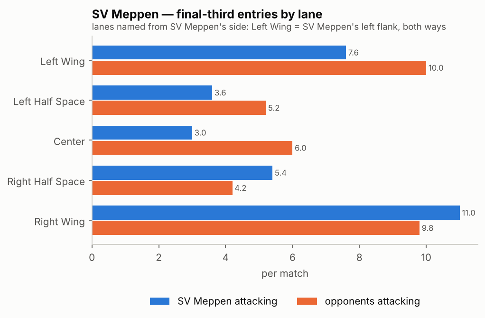
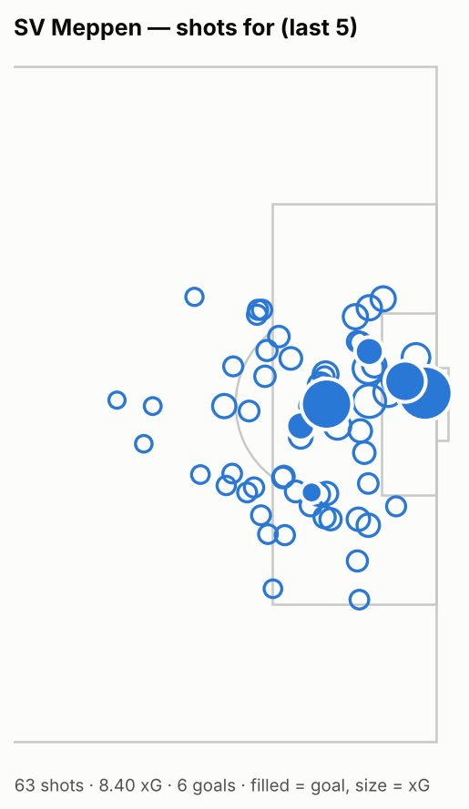
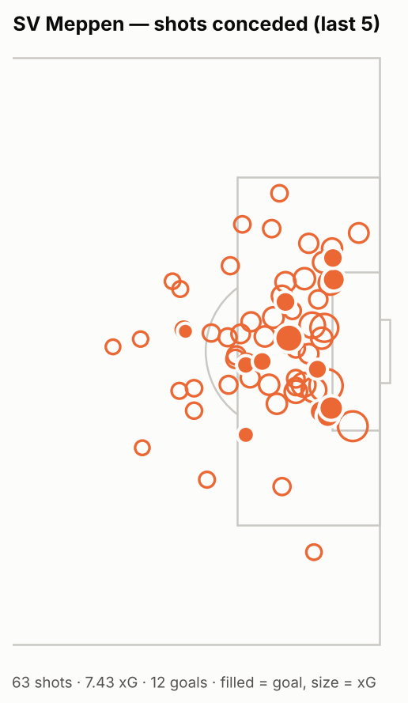
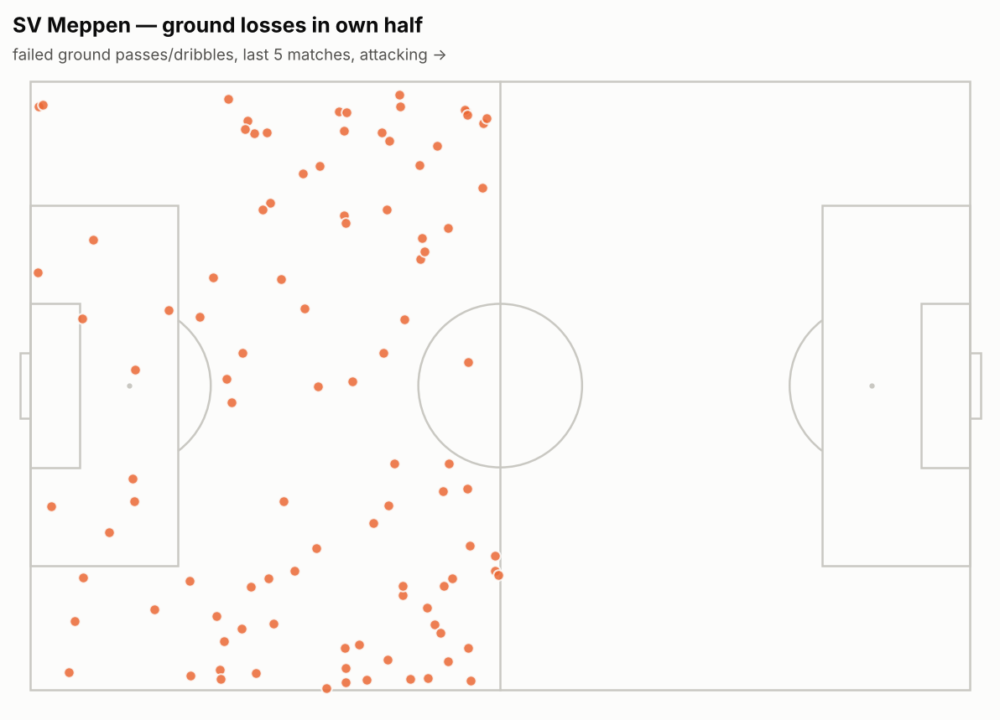

# Opposition report — SV Meppen

_3. Liga 2026-2027 · last 5 matches · 2026-08-29 → 2026-09-19 · W1 D0 L4_

<!-- NARRATIVE: executive summary (how they play, 3 strengths, 3 weaknesses, how to beat them) -->

## Results

| date | opponent | venue | score | result | xg | xg_against | formation | opp_formation |
|---|---|---|---|---|---|---|---|---|
| 2026-08-29 | Alemannia Aachen | A | 3-0 | W | 1.43 | 0.71 | 4-3-3 | 5-2-2-1 |
| 2026-09-05 | 1 FC Saarbrücken | H | 1-6 | L | 1.99 | 2.06 | 4-3-3 | 4-4-2 (flat) |
| 2026-09-12 | SC Verl | A | 1-2 | L | 1.93 | 2.02 | 4-3-3 | 4-2-3-1 |
| 2026-09-15 | FC Viktoria Köln | H | 1-3 | L | 1.77 | 1.31 | 4-3-3 | 5-3-2 |
| 2026-09-19 | TSG 1899 Hoffenheim II | A | 0-1 | L | 1.29 | 1.32 | 4-3-3 | 4-2-3-1 |

**Formations used:** 4-3-3 ×5

## Profile vs league

Rank 1 = highest value among 20 teams (for PPDA, losses and xG against, high is bad).

| metric | per match | league avg | rank |
|---|---|---|---|
| xG for | 1.68 | 1.57 | 7/20 |
| xG against | 1.48 | 1.57 | 14/20 |
| Shots | 12.6 | 12.94 | 13/20 |
| xG per shot | 0.13 | 0.12 | 7/20 |
| Possession % (pass share) | 44.72 | 50.0 | 17/20 |
| Pass accuracy % | 67.8 | 74.99 | 20/20 |
| Long passes % | 16.98 | 13.27 | 2/20 |
| Progressive passes | 27.8 | 26.81 | 7/20 |
| Final-third entries | 30.6 | 33.11 | 14/20 |
| Box entries | 9.6 | 10.67 | 15/20 |
| Crosses | 16.6 | 15.26 | 7/20 |
| Field tilt % | 47.24 | 50.0 | 15/20 |
| PPDA (low = intense press) | 7.52 | 8.61 | 15/20 |
| High regains | 23.8 | 22.44 | 6/20 |
| Ground losses in own half | 20.2 | 19.41 | 7/20 |
| Pressure on opp. build-up | 25.68 | 24.24 | 6/20 |
| Set-piece xG | 0.7 | 0.51 | 4/20 |

## In possession

- Goal kicks played short (<30 m): **55.6%**
- Own-third passes made under pressure (≥50): **27.0%**, completed **47.9%** of those

### xG per match by phase

| phase | for | against |
|---|---|---|
| ATTACKING_TRANSITION | 0.47 | 0.3 |
| IN_POSSESSION | 0.34 | 0.47 |
| SECOND_BALL | 0.17 | 0.21 |
| SET_PIECE | 0.7 | 0.51 |

 

## Out of possession

- PPDA **7.52** (league 8.61), high regains **23.8**/match, pressure on opp. build-up **25.68**
- Opponents' final-third entries by SV Meppen flank (mirrored, per match): left wing 10.0, left half space 5.2, center 6.0, right half space 4.2, right wing 9.8

## Set pieces

| | attacking | defending |
|---|---|---|
| corners_per_match | 5.6 | 3.2 |
| corner_short_pct | 10.7 | 12.5 |
| corner_inswing_pct | 48.0 | 7.1 |
| corner_first_contact_won_pct | 48.0 | 50.0 |
| corner_xg | 2.15 | 0.91 |
| xg_per_corner | 0.077 | 0.057 |
| corner_goals | 1 | 3 |
| attacking_free_kicks | 8 | 16 |
| fk_xg | 0.31 | 0.4 |
| long_throws | 16 | 9 |
| penalties | 1 | 0 |
| set_piece_xg_per_match | 0.92 | 0.51 |
| set_piece_goals | 4 | 5 |

Takers: Thorben Deters (corner, foot_right, 27), Thorben Deters (free_kick, foot_right, 5), Florian Bähr (free_kick, foot_left, 1), Florian Bähr (corner, foot_left, 1)
Main set-piece shooters: Niclas Nadj (4), Ersin Zehir (4), Cyrill Akono (3), Oliver Schmitt (3), Stefan Rankic (2)

## Key players

_Minutes are estimated from first/last event._

| player | position | apps | minutes | goals | shots | xg | key_passes | xa | prog_passes | box_entries | regains | losses | xg+xa_p90 |
|---|---|---|---|---|---|---|---|---|---|---|---|---|---|
| Cyrill Akono | CENTER_FORWARD | 5 | 258 | 2 | 7 | 1.34 | 4 | 0.48 | 5 | 2 | 9 | 13 | 0.63 |
| Oliver Schmitt | LEFT_WINGER | 5 | 383 | 1 | 10 | 2.31 | 3 | 0.28 | 4 | 12 | 29 | 54 | 0.61 |
| Thorben Deters | CENTRAL_MIDFIELD | 5 | 415 | 1 | 5 | 0.46 | 11 | 1.10 | 12 | 5 | 36 | 53 | 0.34 |
| Luca Prasse | RIGHT_WINGER | 5 | 294 | 0 | 7 | 0.67 | 3 | 0.33 | 6 | 3 | 32 | 42 | 0.31 |
| Ersin Zehir | DEFENSE_MIDFIELD | 4 | 359 | 1 | 4 | 0.95 | 1 | 0.07 | 9 | 1 | 40 | 28 | 0.26 |
| Niclas Nadj | CENTRAL_MIDFIELD | 5 | 394 | 1 | 8 | 0.58 | 4 | 0.48 | 12 | 6 | 46 | 41 | 0.24 |
| Dominique Domröse | RIGHT_WINGBACK_DEFENDER | 5 | 457 | 0 | 3 | 0.23 | 8 | 0.89 | 15 | 6 | 47 | 38 | 0.22 |
| Nikell Touglo | CENTRAL_DEFENDER | 3 | 203 | 0 | 2 | 0.27 | 1 | 0.09 | 17 | 2 | 31 | 21 | 0.16 |
| Richard Meier | CENTER_FORWARD | 5 | 228 | 0 | 3 | 0.27 | 1 | 0.05 | 1 | 2 | 13 | 31 | 0.13 |
| Stefan Rankic | CENTRAL_DEFENDER | 5 | 469 | 0 | 2 | 0.24 | 2 | 0.24 | 13 | 2 | 88 | 42 | 0.09 |

<!-- NARRATIVE: game plan recommendations go here -->

---
_xG from the repo's own model. Definitions: analysis/README.md._