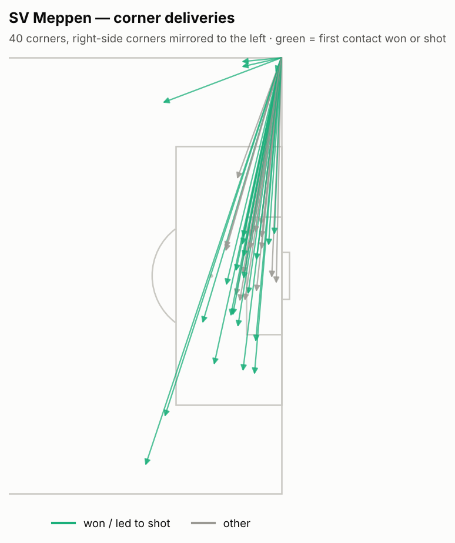
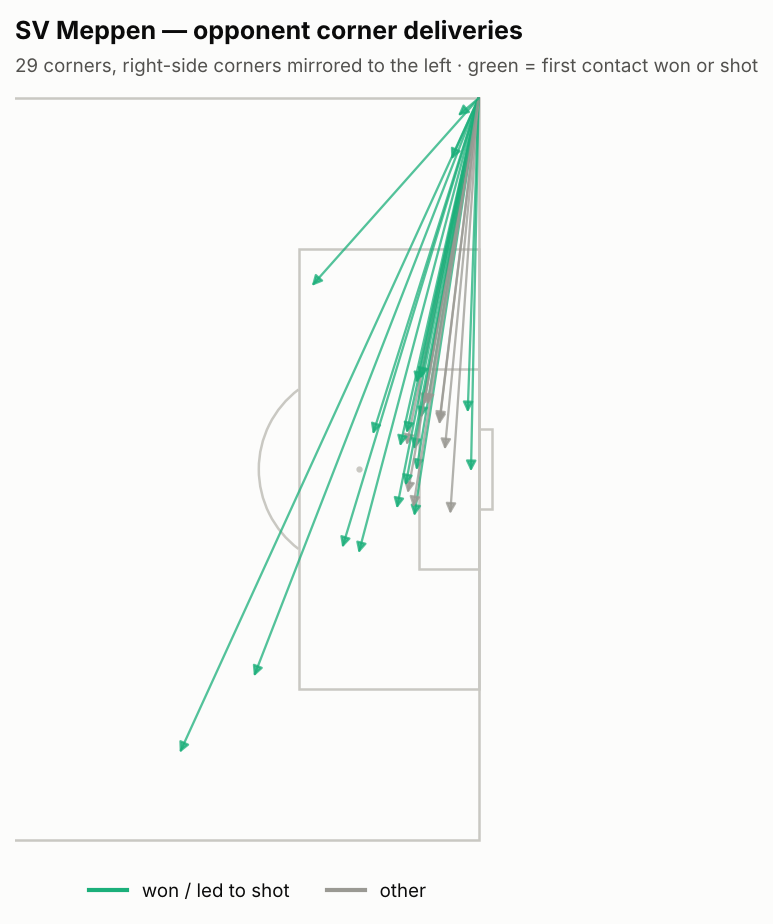
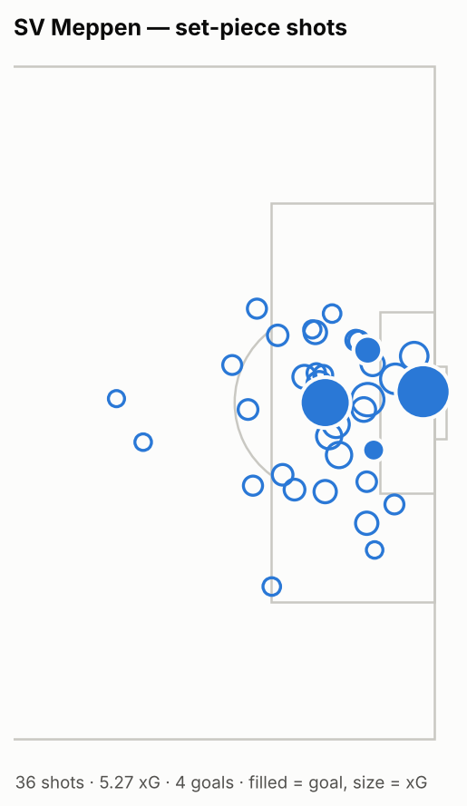
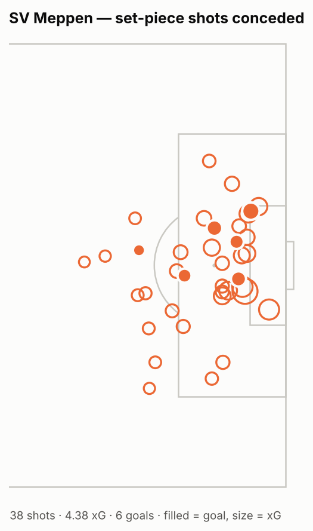

# Set-piece report — SV Meppen

_3. Liga 2026-2027 · 7 matches: 2026-08-08 → 2026-09-19_

<!-- NARRATIVE: headline findings and set-piece game plan -->

## Overview

| | attacking | defending |
|---|---|---|
| Set-piece shots | 30 | 36 |
| Set-piece xG | 4.66 | 4.22 |
| Set-piece xG / match | 0.67 | 0.6 |
| Set-piece goals (incl. pens) | 4 | 6 |
| Penalties | 1 | 0 |
| Counter shots conceded after (≤15 s) | 1 | 0 |
| Counter goals conceded after | 0 | 0 |

### League context

| metric | value | league avg | rank |
|---|---|---|---|
| Set-piece xG for / match | 0.67 | 0.535 | 4/20 |
| Set-piece xG against / match | 0.6 | 0.535 | 9/20 |
| xG per corner (for) | 0.068 | 0.048 | 4/20 |
| xG per corner (against) | 0.083 | 0.051 | 3/20 |
| First contact won, own corners % | 50.0 | 34.51 | 1/20 |
| Opp. first contact won on their corners % (high = bad) | 50.0 | 35.69 | 2/20 |
| Corners won / match | 5.71 | 4.693 | 5/20 |

## Corners

| | attacking | defending |
|---|---|---|
| Corners | 40 | 30 |
| Per match | 5.71 | 4.29 |
| Short % | 10.0 | 6.7 |
| Inswing % (delivered) | 44.4 | 32.1 |
| First contact won % | 50.0 | 50.0 |
| Shots | 16 | 19 |
| xG | 2.7 | 2.49 |
| xG per corner | 0.068 | 0.083 |
| Goals | 2 | 4 |
| Target zones | near post 15, far post 12, central 4, short / outside box 2, 6-yard box 2, penalty spot / edge 1 | near post 12, far post 6, central 3, 6-yard box 2, short / outside box 2, penalty spot / edge 2 |

 

## Free kicks, throw-ins, goal kicks

| | attacking | defending |
|---|---|---|
| Free kicks in final third | 10 | 22 |
| Direct FK shots | 0 | 6 |
| FK xG | 0.31 | 0.51 |
| FK goals | 0 | 2 |
| Throw-ins | 141 | 161 |
| Long throws into the box area | 19 | 13 |
| Long-throw xG | 0.21 | 0.7 |
| Goal kicks | 53 | 69 |
| Goal kicks short % | 60.4 | 63.8 |

 

## People

**Takers**

| taker | type | foot | n |
|---|---|---|---|
| Thorben Deters | CORNER | FOOT_RIGHT | 36 |
| Thorben Deters | FREE_KICK | FOOT_RIGHT | 6 |
| Florian Bähr | CORNER | FOOT_LEFT | 4 |
| Florian Bähr | FREE_KICK | FOOT_LEFT | 2 |
| Luca Prasse | FREE_KICK | FOOT_RIGHT | 1 |
| Jannic Ehlers | FREE_KICK | FOOT_RIGHT | 1 |

**Set-piece shooters (targets)**

| player | set_piece_shots |
|---|---|
| Oliver Schmitt | 6 |
| Niclas Nadj | 5 |
| Cyrill Akono | 4 |
| Ersin Zehir | 4 |
| Stefan Rankic | 3 |
| Jona Borsum | 3 |
| Simon Engelmann | 2 |
| Luca Prasse | 2 |

## Every dangerous set piece

| match | clock | type | team | taker | target_zone | first_contact | shots | xg | goals | shooters | counter_shots_conceded |
|---|---|---|---|---|---|---|---|---|---|---|---|
| 2026-08-08 MSV Duisburg vs SV Meppen | 00:16.0520 | THROW_IN | SV Meppen | Tobias Mißner |  | TEAMMATE | 1 | 0.20 | 0 | Oliver Schmitt | 0 |
| 2026-08-08 MSV Duisburg vs SV Meppen | 11:29.7700 | THROW_IN | MSV Duisburg | Joshua Bitter |  | OPPONENT | 1 | 0.08 | 0 | Jakob Bookjans | 0 |
| 2026-08-08 MSV Duisburg vs SV Meppen | 18:20.7380 | CORNER | SV Meppen | Thorben Deters | far post | TEAMMATE | 1 | 0.04 | 0 | Oliver Schmitt | 0 |
| 2026-08-08 MSV Duisburg vs SV Meppen | 24:50.3620 | CORNER | MSV Duisburg | Dominik Kother | central | TEAMMATE | 1 | 0.16 | 0 | Lex Tyger Lobinger | 0 |
| 2026-08-08 MSV Duisburg vs SV Meppen | 26:31.7230 | CORNER | MSV Duisburg | Dominik Kother | near post | OPPONENT | 2 | 0.24 | 0 | Christian Viet; Jakob Bookjans | 0 |
| 2026-08-08 MSV Duisburg vs SV Meppen | 27:16.8920 | CORNER | MSV Duisburg | Dominik Kother | near post | OPPONENT | 1 | 0.06 | 0 | Jakob Bookjans | 0 |
| 2026-08-08 MSV Duisburg vs SV Meppen | 27:54.2510 | CORNER | MSV Duisburg | Dominik Kother | 6-yard box |  | 1 | 0.15 | 0 | Lex Tyger Lobinger | 0 |
| 2026-08-08 MSV Duisburg vs SV Meppen | 53:15.5940 | CORNER | SV Meppen | Thorben Deters | far post |  | 1 | 0.21 | 0 | Cyrill Akono | 0 |
| 2026-08-08 MSV Duisburg vs SV Meppen | 63:25.8380 | CORNER | MSV Duisburg | Conor Noß | far post | TEAMMATE | 1 | 0.12 | 0 | Ben Schlicke | 0 |
| 2026-08-08 MSV Duisburg vs SV Meppen | 63:50.7110 | CORNER | MSV Duisburg | Conor Noß | far post | TEAMMATE | 1 | 0.11 | 1 | Ben Schlicke | 0 |
| 2026-08-08 MSV Duisburg vs SV Meppen | 67:23.7930 | FREE_KICK | SV Meppen | Thorben Deters | near post | OPPONENT | 0 | 0.00 | 0 |  | 1 |
| 2026-08-08 MSV Duisburg vs SV Meppen | 74:44.8250 | FREE_KICK | MSV Duisburg | Can Coskun | near post |  | 1 | 0.07 | 0 | Can Coskun | 0 |
| 2026-08-08 MSV Duisburg vs SV Meppen | 75:17.7810 | CORNER | MSV Duisburg | Conor Noß | near post | TEAMMATE | 1 | 0.25 | 0 | Lex Tyger Lobinger | 0 |
| 2026-08-08 MSV Duisburg vs SV Meppen | 90:00.0000 (+01:41.6170) | THROW_IN | SV Meppen | Luca Prasse |  | OPPONENT | 1 | 0.15 | 0 | Simon Engelmann | 0 |
| 2026-08-15 SV Meppen vs SG Sonnenhof Großaspach | 00:18.4880 | THROW_IN | SV Meppen | Tobias Mißner |  | TEAMMATE | 1 | 0.06 | 0 | Niclas Nadj | 0 |
| 2026-08-15 SV Meppen vs SG Sonnenhof Großaspach | 05:27.0510 | CORNER | SV Meppen | Thorben Deters | near post | TEAMMATE | 1 | 0.11 | 1 | Stefan Rankic | 0 |
| 2026-08-15 SV Meppen vs SG Sonnenhof Großaspach | 18:14.2350 | THROW_IN | SV Meppen | Tobias Mißner |  | TEAMMATE | 1 | 0.12 | 0 | Luca Prasse | 0 |
| 2026-08-15 SV Meppen vs SG Sonnenhof Großaspach | 18:59.7090 | CORNER | SV Meppen | Thorben Deters | penalty spot / edge | TEAMMATE | 1 | 0.05 | 0 | Oliver Schmitt | 0 |
| 2026-08-15 SV Meppen vs SG Sonnenhof Großaspach | 25:43.3920 | FREE_KICK | SG Sonnenhof Großaspach | Tim Rossmann | far post | TEAMMATE | 1 | 0.08 | 0 | Arbnor Nuraj | 0 |
| 2026-08-15 SV Meppen vs SG Sonnenhof Großaspach | 40:20.1030 | FREE_KICK | SG Sonnenhof Großaspach | Niklas Pollex | penalty spot / edge |  | 1 | 0.05 | 0 | Niklas Pollex | 0 |
| 2026-08-15 SV Meppen vs SG Sonnenhof Großaspach | 47:38.8020 | CORNER | SG Sonnenhof Großaspach | Tim Rossmann | short / outside box | TEAMMATE | 1 | 0.25 | 0 | Volkan Celiktas | 0 |
| 2026-08-15 SV Meppen vs SG Sonnenhof Großaspach | 52:44.6570 | CORNER | SV Meppen | Thorben Deters | central | TEAMMATE | 1 | 0.13 | 0 | Richard Meier | 0 |
| 2026-08-15 SV Meppen vs SG Sonnenhof Großaspach | 68:08.6729 | THROW_IN | SV Meppen | Tobias Mißner |  | TEAMMATE | 1 | 0.16 | 0 | Thorben Deters | 0 |
| 2026-08-15 SV Meppen vs SG Sonnenhof Großaspach | 70:24.7280 | CORNER | SG Sonnenhof Großaspach | Lukas Stoppel | penalty spot / edge | TEAMMATE | 1 | 0.11 | 0 | Luca Molinari | 0 |
| 2026-08-15 SV Meppen vs SG Sonnenhof Großaspach | 71:02.9180 | CORNER | SG Sonnenhof Großaspach | Tim Rossmann | central |  | 1 | 0.06 | 0 | Lukas Stoppel | 0 |
| 2026-08-15 SV Meppen vs SG Sonnenhof Großaspach | 82:26.6880 | FREE_KICK | SV Meppen | Ersin Zehir | short / outside box | TEAMMATE | 1 | 0.11 | 0 | Jona Borsum | 0 |
| 2026-08-15 SV Meppen vs SG Sonnenhof Großaspach | 83:26.2060 | THROW_IN | SG Sonnenhof Großaspach | Luca Molinari |  | TEAMMATE | 0 | 0.00 | 0 |  | 1 |
| 2026-08-15 SV Meppen vs SG Sonnenhof Großaspach | 89:32.3220 | CORNER | SG Sonnenhof Großaspach | Lukas Stoppel | penalty spot / edge | TEAMMATE | 1 | 0.08 | 0 | Deli Hajdini | 0 |
| 2026-08-15 SV Meppen vs SG Sonnenhof Großaspach | 90:00.0000 (+04:07.3109) | FREE_KICK | SV Meppen | Dominique Domröse | far post | TEAMMATE | 1 | 0.05 | 0 | Jona Borsum | 0 |
| 2026-08-29 Alemannia Aachen vs SV Meppen | 05:21.8100 | THROW_IN | SV Meppen | Luca Prasse |  | OPPONENT | 1 | 0.04 | 0 | Tobias Mißner | 0 |
| 2026-08-29 Alemannia Aachen vs SV Meppen | 08:15.2549 | FREE_KICK | SV Meppen | Luis Sprekelmeyer | short / outside box | TEAMMATE | 1 | 0.21 | 1 | Thorben Deters | 0 |
| 2026-08-29 Alemannia Aachen vs SV Meppen | 10:10.5160 | THROW_IN | SV Meppen | Tobias Mißner |  | TEAMMATE | 1 | 0.21 | 1 | Cyrill Akono | 0 |
| 2026-08-29 Alemannia Aachen vs SV Meppen | 15:40.2989 | FREE_KICK | Alemannia Aachen | Meiko Wäschenbach | penalty spot / edge | OPPONENT | 1 | 0.08 | 0 | Kacper Koscierski | 0 |
| 2026-08-29 Alemannia Aachen vs SV Meppen | 20:27.5300 | FREE_KICK | Alemannia Aachen | Matti Wagner | short / outside box | TEAMMATE | 1 | 0.09 | 0 | Joel da Silva Kiala | 0 |
| 2026-08-29 Alemannia Aachen vs SV Meppen | 21:49.1470 | CORNER | SV Meppen | Thorben Deters | near post | TEAMMATE | 1 | 0.08 | 0 | Niclas Nadj | 0 |
| 2026-08-29 Alemannia Aachen vs SV Meppen | 26:45.1580 | FREE_KICK | SV Meppen | Thorben Deters | penalty spot / edge | OPPONENT | 1 | 0.11 | 0 | Oliver Schmitt | 0 |
| 2026-08-29 Alemannia Aachen vs SV Meppen | 38:21.0030 | CORNER | Alemannia Aachen | Matti Wagner | short / outside box | TEAMMATE | 1 | 0.09 | 0 | Danilo Wiebe | 0 |
| 2026-08-29 Alemannia Aachen vs SV Meppen | 64:37.2140 | CORNER | Alemannia Aachen | Nathan Bitumazala | near post | TEAMMATE | 1 | 0.08 | 0 | Joel da Silva Kiala | 0 |
| 2026-08-29 Alemannia Aachen vs SV Meppen | 67:38.1970 | CORNER | SV Meppen | Thorben Deters | far post | TEAMMATE | 1 | 0.07 | 0 | Stefan Rankic | 0 |
| 2026-08-29 Alemannia Aachen vs SV Meppen | 68:31.9110 | CORNER | SV Meppen | Thorben Deters | far post | TEAMMATE | 1 | 0.07 | 0 | Niclas Nadj | 0 |
| 2026-08-29 Alemannia Aachen vs SV Meppen | 80:44.5780 | THROW_IN | Alemannia Aachen | Matti Wagner |  | TEAMMATE | 1 | 0.09 | 0 | Louis Köster | 0 |
| 2026-08-29 Alemannia Aachen vs SV Meppen | 87:59.2930 | FREE_KICK | Alemannia Aachen | Lukas Scepanik | 6-yard box |  | 1 | 0.04 | 0 | Lukas Scepanik | 0 |
| 2026-09-05 SV Meppen vs 1 FC Saarbrücken | 03:59.0480 | CORNER | 1 FC Saarbrücken | Daniel Gleiber | near post | TEAMMATE | 1 | 0.17 | 1 | Siemen Voet | 0 |
| 2026-09-05 SV Meppen vs 1 FC Saarbrücken | 06:07.0670 | THROW_IN | SV Meppen | Tobias Mißner |  | TEAMMATE | 1 | 0.09 | 0 | Niclas Nadj | 0 |
| 2026-09-05 SV Meppen vs 1 FC Saarbrücken | 09:37.2680 | FREE_KICK | SV Meppen | Thorben Deters | penalty spot / edge | TEAMMATE | 3 | 0.40 | 0 | Stefan Rankic; Dominique Domröse; Luca Prasse | 0 |
| 2026-09-05 SV Meppen vs 1 FC Saarbrücken | 09:58.8809 | THROW_IN | SV Meppen | Dominique Domröse |  | OPPONENT | 1 | 0.05 | 0 | Ersin Zehir | 0 |
| 2026-09-05 SV Meppen vs 1 FC Saarbrücken | 29:56.5290 | CORNER | SV Meppen | Thorben Deters | near post | TEAMMATE | 1 | 0.19 | 0 | Nikell Touglo | 0 |
| 2026-09-05 SV Meppen vs 1 FC Saarbrücken | 38:46.6160 | CORNER | 1 FC Saarbrücken | Daniel Gleiber | near post | TEAMMATE | 1 | 0.18 | 0 | Christian Kühlwetter | 0 |
| 2026-09-05 SV Meppen vs 1 FC Saarbrücken | 46:57.0720 | THROW_IN | SV Meppen | Tobias Mißner |  | OPPONENT | 1 | 0.07 | 0 | Ersin Zehir | 0 |
| 2026-09-05 SV Meppen vs 1 FC Saarbrücken | 48:58.1170 | FREE_KICK | 1 FC Saarbrücken | Daniel Gleiber | far post |  | 1 | 0.05 | 0 | Daniel Gleiber | 0 |
| 2026-09-05 SV Meppen vs 1 FC Saarbrücken | 57:56.0930 | FREE_KICK | 1 FC Saarbrücken | Florian Pick | near post | OPPONENT | 1 | 0.10 | 1 | Siemen Voet | 0 |
| 2026-09-05 SV Meppen vs 1 FC Saarbrücken | 36:56.5490 | PENALTY | SV Meppen | Ersin Zehir |  |  | 1 | 0.76 | 1 | Ersin Zehir | 0 |
| 2026-09-12 SC Verl vs SV Meppen | 05:25.2970 | THROW_IN | SC Verl | André Leipold |  | TEAMMATE | 2 | 0.46 | 0 | Fabian Wessig; Amin Farouk | 0 |
| 2026-09-12 SC Verl vs SV Meppen | 17:50.9310 | CORNER | SV Meppen | Thorben Deters | far post | TEAMMATE | 1 | 0.07 | 0 | Luis Sprekelmeyer | 0 |
| 2026-09-12 SC Verl vs SV Meppen | 23:32.9760 | FREE_KICK | SV Meppen | Thorben Deters | short / outside box | TEAMMATE | 1 | 0.04 | 0 | Niclas Nadj | 0 |
| 2026-09-12 SC Verl vs SV Meppen | 28:02.2150 | THROW_IN | SC Verl | André Leipold |  | OPPONENT | 1 | 0.18 | 0 | André Leipold | 0 |
| 2026-09-12 SC Verl vs SV Meppen | 36:00.8780 | THROW_IN | SC Verl | Niko Kijewski |  | OPPONENT | 0 | 0.00 | 0 |  | 1 |
| 2026-09-12 SC Verl vs SV Meppen | 37:28.3560 | THROW_IN | SC Verl | Niko Kijewski |  | TEAMMATE | 0 | 0.00 | 0 |  | 1 |
| 2026-09-12 SC Verl vs SV Meppen | 45:00.0000 (+00:04.0850) | CORNER | SV Meppen | Thorben Deters | near post | TEAMMATE | 2 | 1.17 | 1 | Oliver Schmitt; Oliver Schmitt | 0 |
| 2026-09-12 SC Verl vs SV Meppen | 47:25.2110 | FREE_KICK | SC Verl | Tim Heike | near post |  | 1 | 0.05 | 0 | Tim Heike | 0 |
| 2026-09-12 SC Verl vs SV Meppen | 52:05.8300 | FREE_KICK | SC Verl | Tim Heike | near post |  | 1 | 0.06 | 1 | Tim Heike | 0 |
| 2026-09-12 SC Verl vs SV Meppen | 79:53.9190 | CORNER | SV Meppen | Thorben Deters | central | OPPONENT | 1 | 0.11 | 0 | Jona Borsum | 0 |
| 2026-09-12 SC Verl vs SV Meppen | 85:24.9660 | THROW_IN | SC Verl | Niko Kijewski |  | TEAMMATE | 1 | 0.10 | 0 | Almin Mesanovic | 0 |
| 2026-09-15 SV Meppen vs FC Viktoria Köln | 19:46.5279 | THROW_IN | FC Viktoria Köln | Pascal Fallmann |  | TEAMMATE | 1 | 0.06 | 0 | Niklas Castelle | 0 |
| 2026-09-15 SV Meppen vs FC Viktoria Köln | 25:32.6730 | THROW_IN | FC Viktoria Köln | Meiko Sponsel |  | TEAMMATE | 1 | 0.16 | 0 | David Otto | 0 |
| 2026-09-15 SV Meppen vs FC Viktoria Köln | 32:04.7940 | CORNER | FC Viktoria Köln | Pascal Fallmann | central | TEAMMATE | 2 | 0.27 | 1 | Tim Kloss; Lucas Wolf | 0 |
| 2026-09-15 SV Meppen vs FC Viktoria Köln | 53:09.2090 | THROW_IN | FC Viktoria Köln | Meiko Sponsel |  | OPPONENT | 1 | 0.09 | 0 | Lucas Wolf | 0 |
| 2026-09-15 SV Meppen vs FC Viktoria Köln | 54:41.5670 | CORNER | FC Viktoria Köln | Pascal Fallmann | near post | TEAMMATE | 1 | 0.12 | 1 | Tim Kloss | 0 |
| 2026-09-15 SV Meppen vs FC Viktoria Köln | 72:03.0710 | FREE_KICK | SV Meppen | Thorben Deters | near post | OPPONENT | 1 | 0.09 | 0 | Jannic Ehlers | 0 |
| 2026-09-15 SV Meppen vs FC Viktoria Köln | 82:38.9090 | CORNER | SV Meppen | Thorben Deters | near post | TEAMMATE | 1 | 0.23 | 0 | Cyrill Akono | 0 |
| 2026-09-15 SV Meppen vs FC Viktoria Köln | 84:59.1130 | FREE_KICK | FC Viktoria Köln | Meiko Sponsel | short / outside box |  | 1 | 0.04 | 0 | Marco Pledl | 0 |
| 2026-09-15 SV Meppen vs FC Viktoria Köln | 85:45.6700 | THROW_IN | SV Meppen | Tobias Mißner |  | TEAMMATE | 1 | 0.10 | 0 | Jannic Ehlers | 0 |
| 2026-09-15 SV Meppen vs FC Viktoria Köln | 86:51.8630 | CORNER | SV Meppen | Thorben Deters | far post | TEAMMATE | 1 | 0.08 | 0 | Nikell Touglo | 0 |
| 2026-09-15 SV Meppen vs FC Viktoria Köln | 90:00.0000 (+01:04.5430) | FREE_KICK | SV Meppen | Jannic Ehlers | penalty spot / edge | TEAMMATE | 1 | 0.07 | 0 | Simon Engelmann | 0 |
| 2026-09-19 TSG 1899 Hoffenheim II vs SV Meppen | 06:08.5370 | CORNER | SV Meppen | Thorben Deters | far post | TEAMMATE | 1 | 0.08 | 0 | Luis Sprekelmeyer | 0 |
| 2026-09-19 TSG 1899 Hoffenheim II vs SV Meppen | 22:40.4840 | FREE_KICK | SV Meppen | Thorben Deters | short / outside box | OPPONENT | 1 | 0.07 | 0 | Ersin Zehir | 0 |
| 2026-09-19 TSG 1899 Hoffenheim II vs SV Meppen | 50:33.6990 | THROW_IN | SV Meppen | Jannic Ehlers |  | TEAMMATE | 1 | 0.12 | 0 | Cyrill Akono | 0 |

<!-- NARRATIVE: routines spotted, matchups, recommendations -->

---
_Set-piece shots = shots in the set-piece sequence or ≤10 s after it, plus penalties. Full list of restarts: set_pieces.csv. Definitions: analysis/README.md._